# Lab1 + Lab2
## Lab1 :
## I. Manual Workflow - without using Jenkins
### Step 1: Create a Docker file

### Step 2: Build a docker image

### Step 3: Push Docker Image on Docker Hub

### Step 4: Deploy application on K3S using kubectl

## II. Jenkins Freestyle Workflow
### Step 1

### Step 2

### Step 3

### Step 4

### Step 5 - Jenkins Freestyle Workflow - Challenge

## Lab2 :
### Préparer le projet GitHub : Forker le dépôt
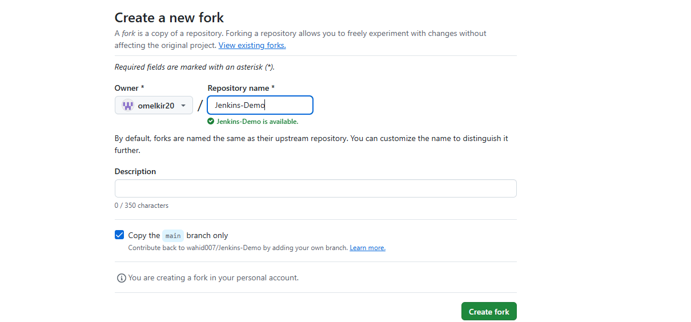
### Vérifier le Dockerfile
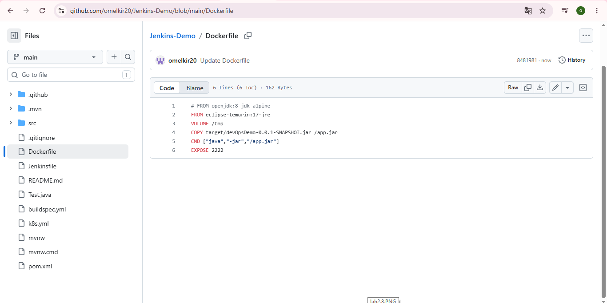
### Vérifier le Jenkinsfile
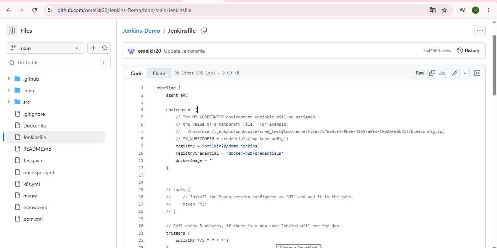
### Créer le pipeline dans Jenkins
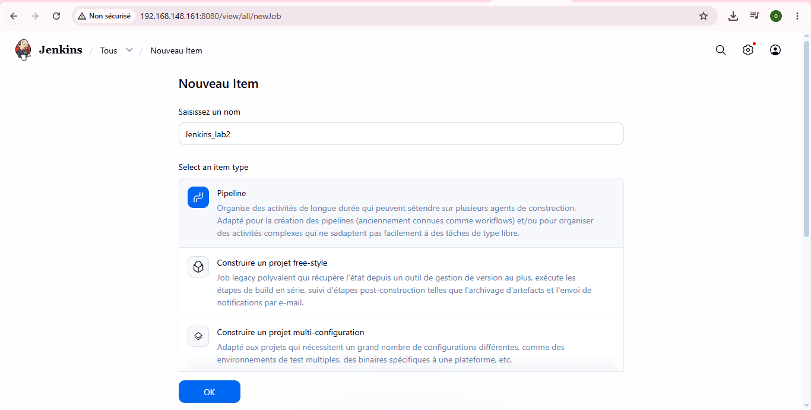
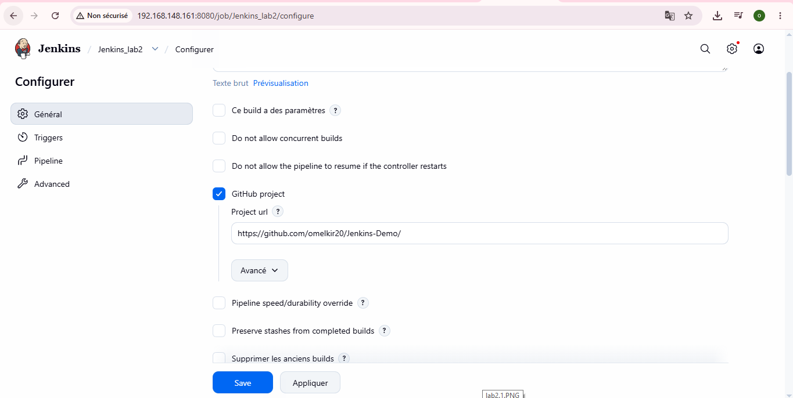
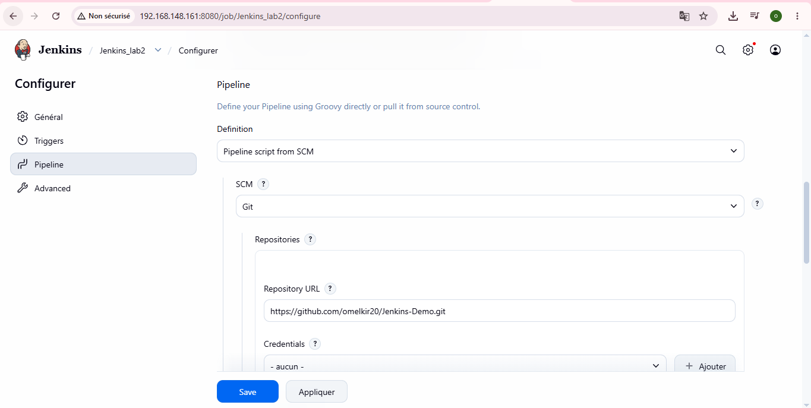
### Configurer Maven dans Jenkins
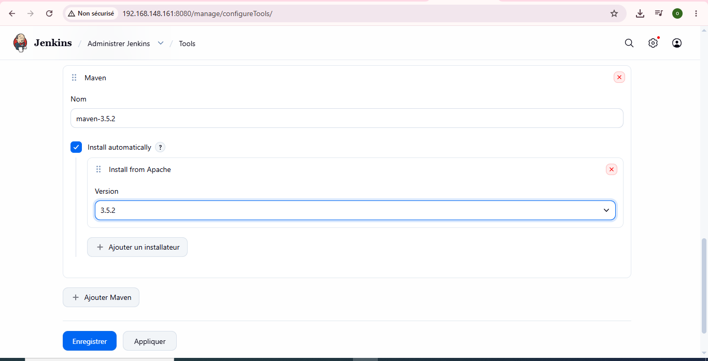
### Créer le credential Docker Hub dans Jenkins
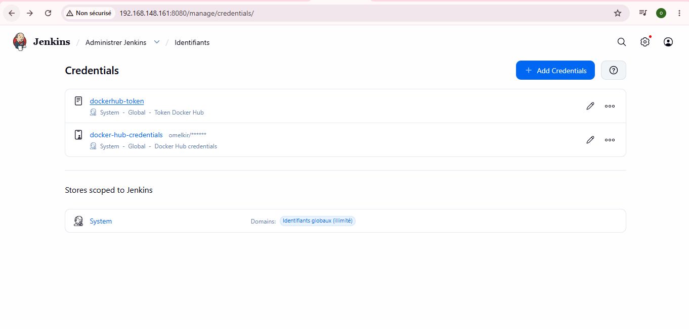
### Lancer le pipeline
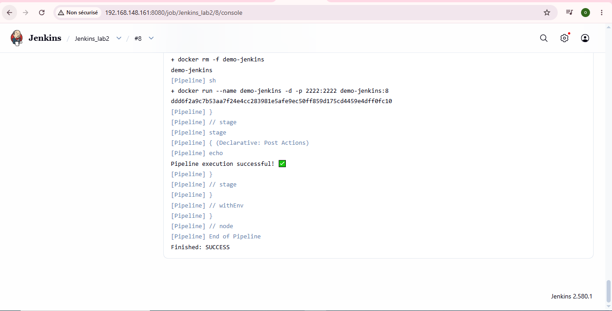
### Tester l'application
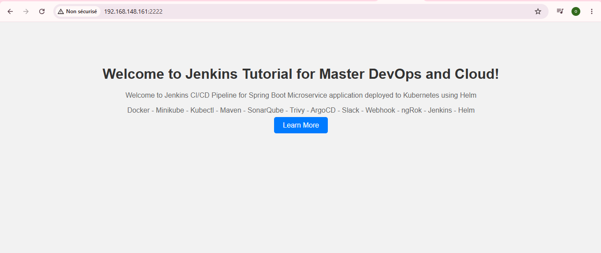
### Vérifie le conteneur Docker 
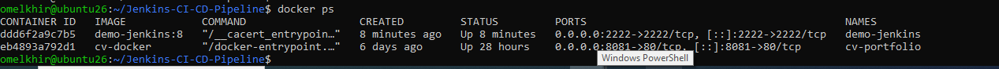
