# Lab1 + Lab2
## Lab1 :
## I. Manual Workflow - without using Jenkins
### Step 1: Create a Docker file
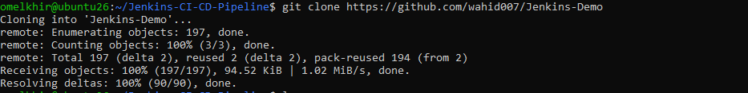
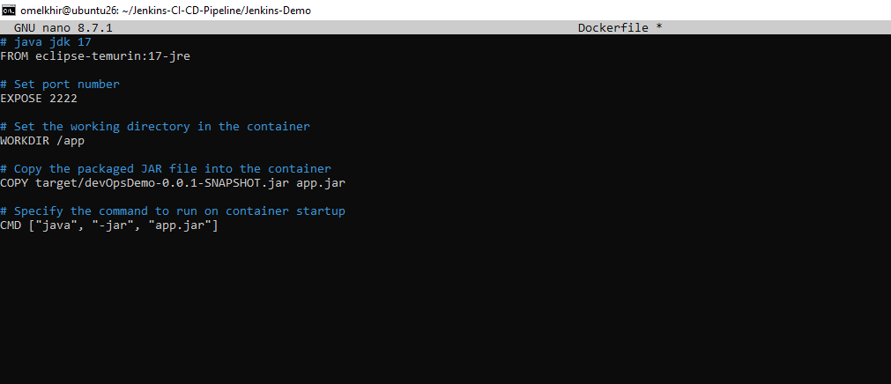
### Step 2: Build a docker image
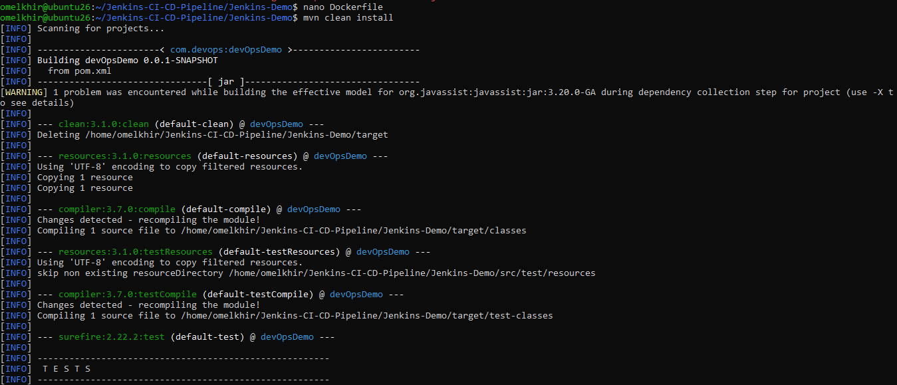
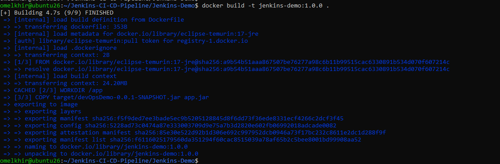
### Step 3: Push Docker Image on Docker Hub
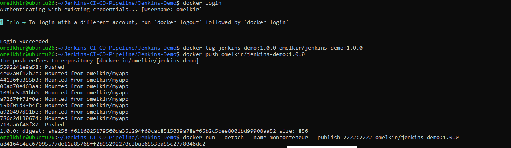
### Step 4: Deploy application on K3S using kubectl
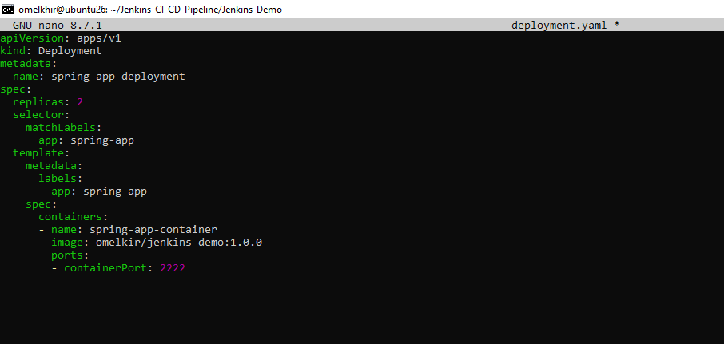
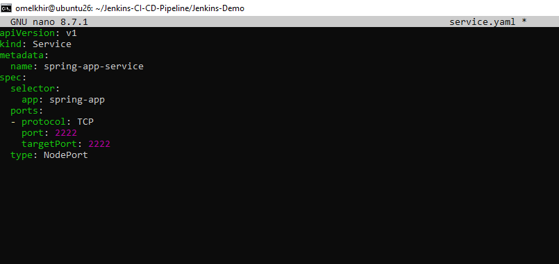
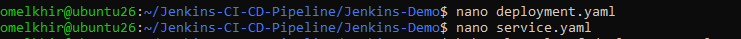
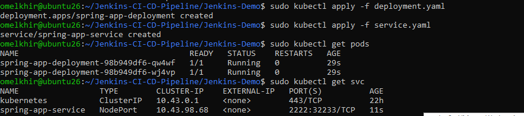
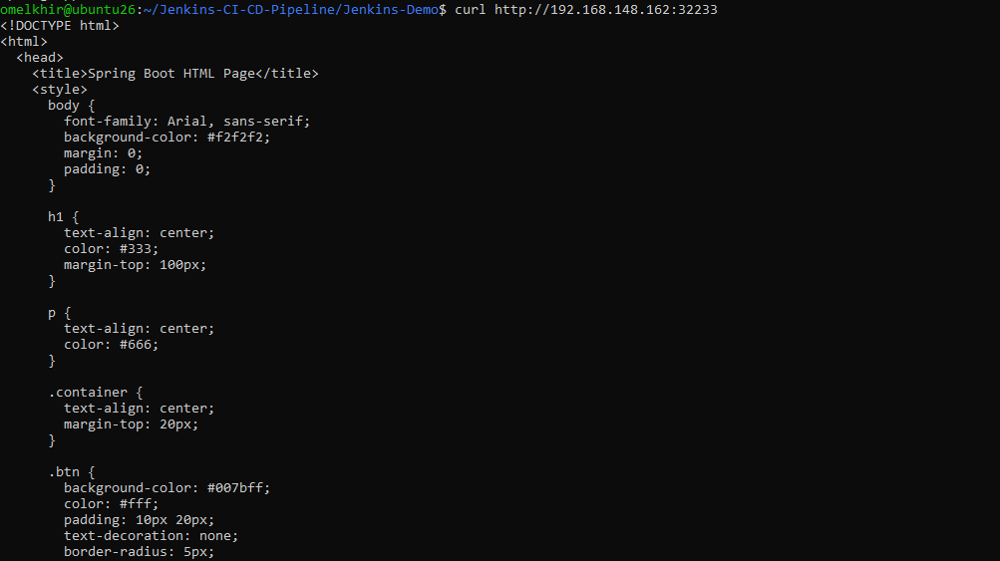
## II. Jenkins Freestyle Workflow
### Step 1
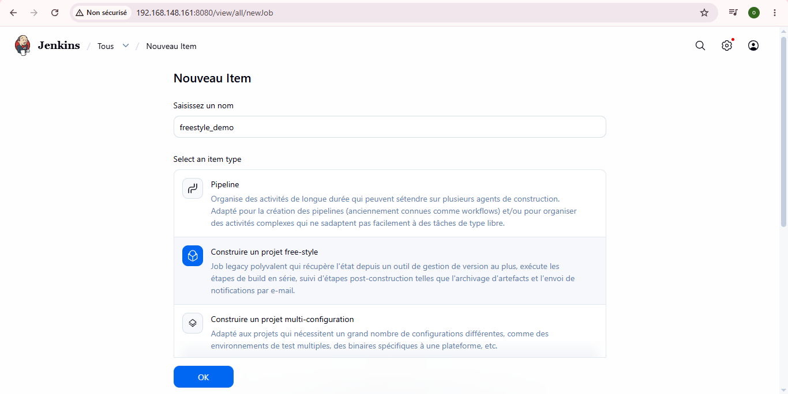
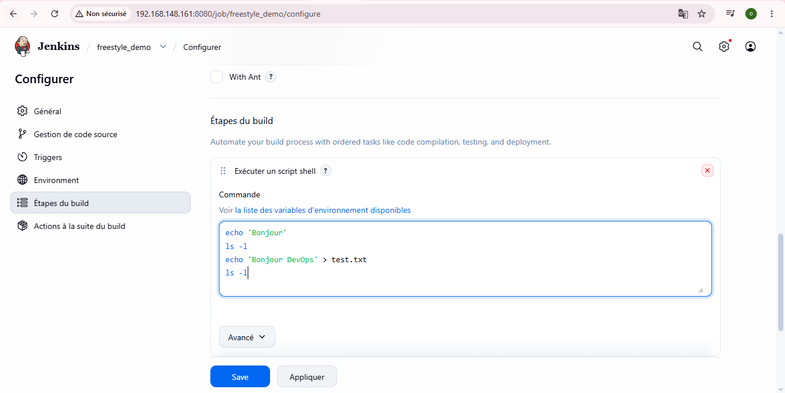
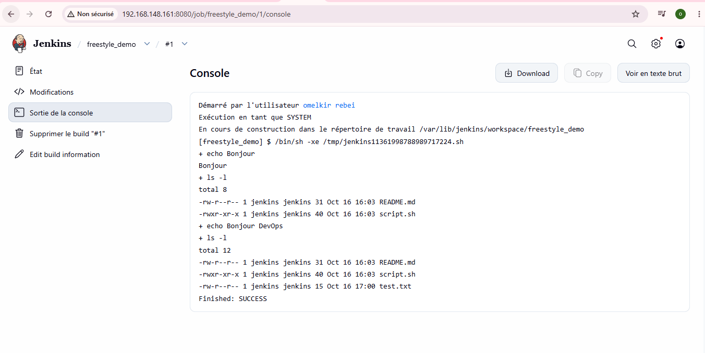
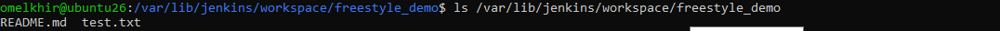
### Step 2
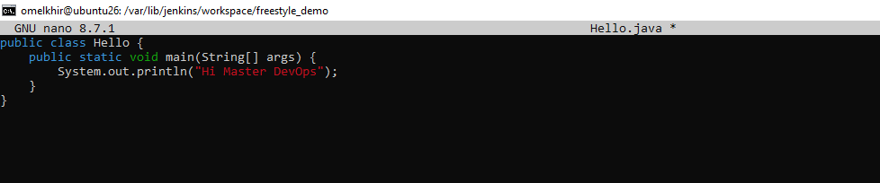
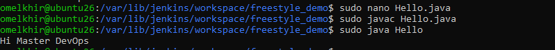
### Step 3
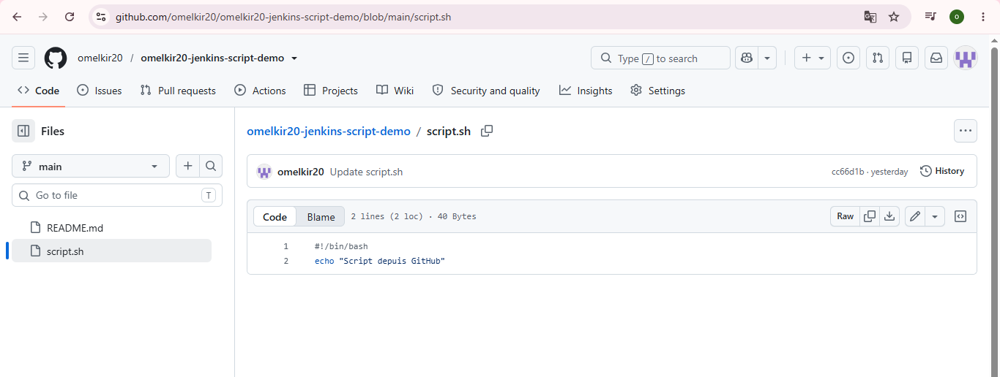

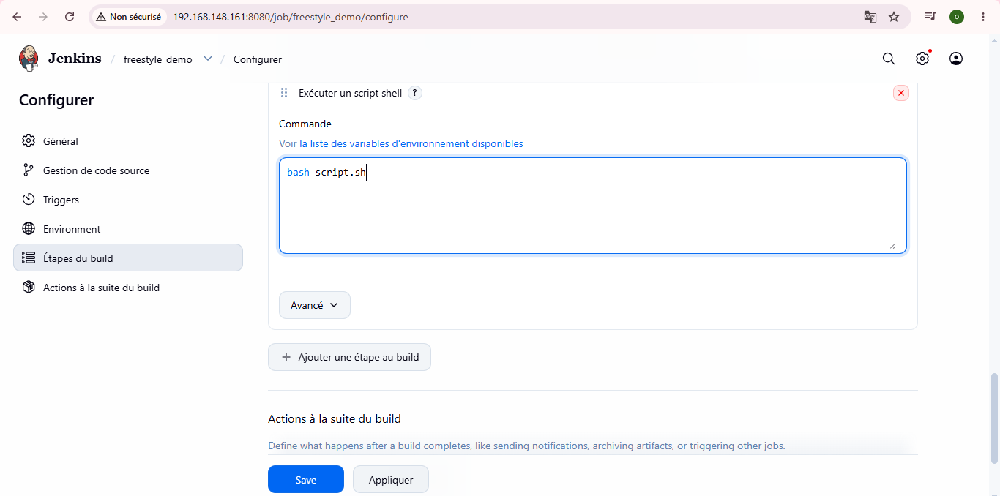
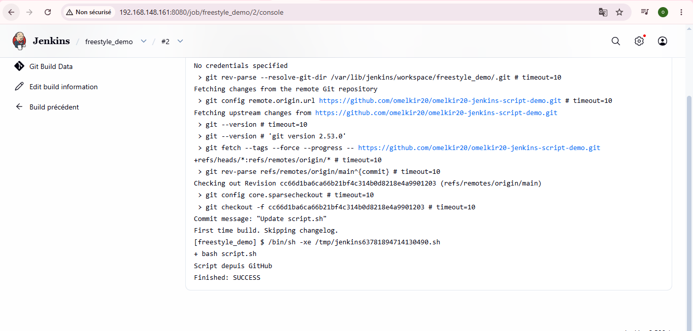
### Step 4
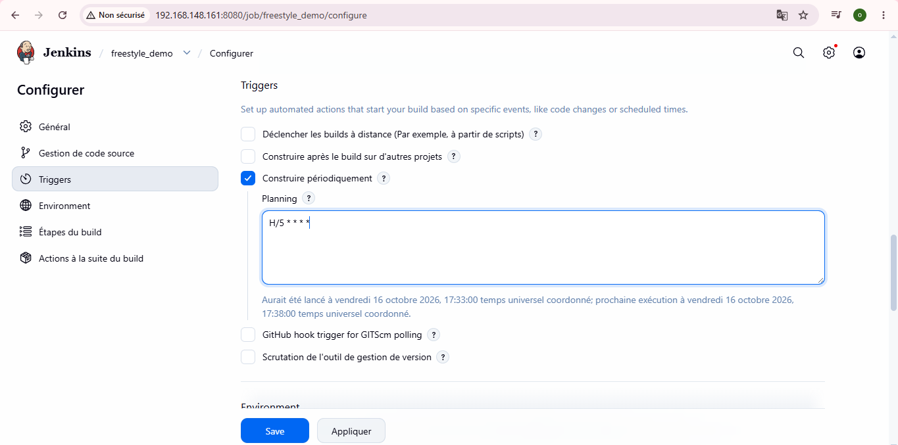
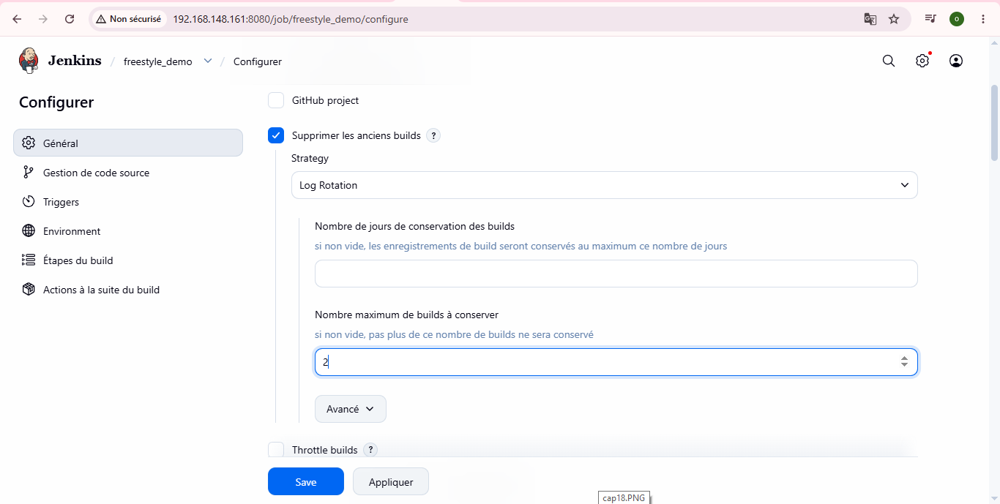
### Step 5 - Jenkins Freestyle Workflow - Challenge

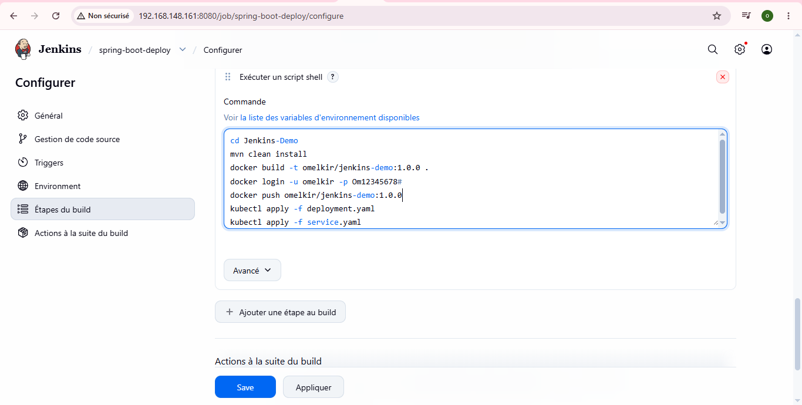
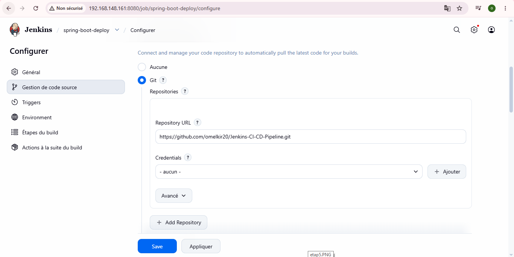
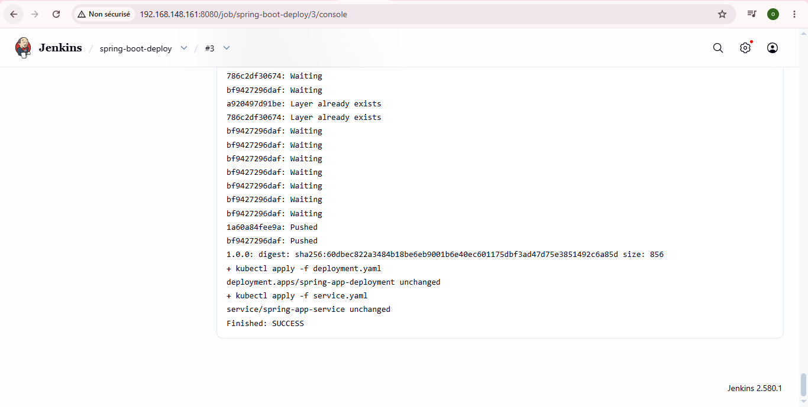
